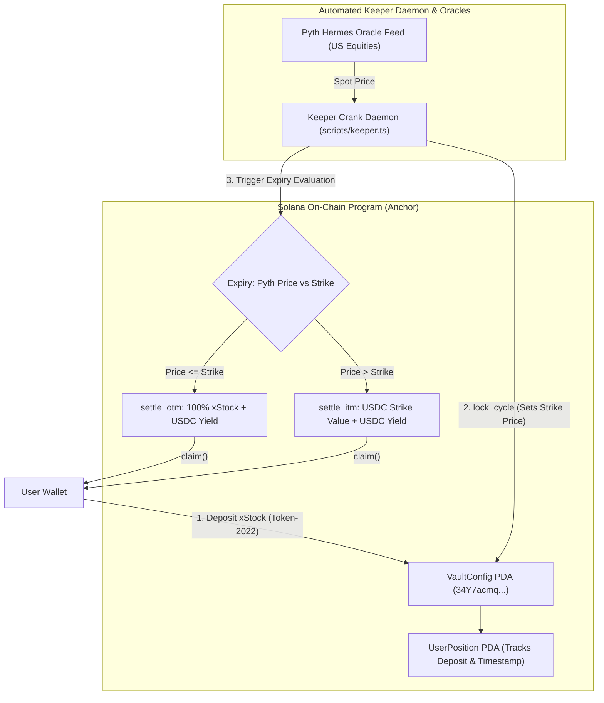

# Project Dossier: Harvest (Covered-Call Yield Vaults for Tokenized Equities on Solana)

**Dossier Generation Date:** October 3, 2026  
**Investigator:** Antigravity Engineering Portfolio Intelligence Analyst  
**Repository Path:** [`/home/lala_02/harvest`](file:///home/lala_02/harvest)  
**Remote URL:** [`git@github.com:Olalolo22/harvest.git`](https://github.com/Olalolo22/harvest)  
**Active Feature Branch:** `design-v2` (+12 commits ahead of `main`)  
**Solana Devnet Program ID:** [`34Y7acmqWosmkfPJjqRUQzrHFdxmxpQezLSvgD9bLJJo`](https://explorer.solana.com/address/34Y7acmqWosmkfPJjqRUQzrHFdxmxpQezLSvgD9bLJJo?cluster=devnet)  
**Evidence Standard:** **E1 (Anchor Source Code, Fixed-Point Math, Automated Keeper Script)**

---

## A. Identity and Purpose

- **Project Name:** Harvest
- **Repository URL:** [`https://github.com/Olalolo22/harvest`](https://github.com/Olalolo22/harvest)
- **Relevant Branches:** `main`, `design-v2`
- **What It Does:** Decentralized, non-custodial covered-call option yield vaults designed specifically for tokenized US equities (Backed Finance xStocks: `AAPLx`, `NVDAx`, `TSLAx`) on Solana. Stock holders deposit their synthetic equity tokens into a cycle-based vault. An automated off-chain keeper locks the cycle using **Pyth Network Hermes oracles** to establish the covered-call strike price. At cycle expiry, the vault automatically executes OTM (out-of-the-money) or ITM (in-the-money) settlements, allowing depositors to harvest recurring **USDC premiums** while maintaining non-custodial principal protection.
- **Specific Problem Addressed:** Tokenized stocks on Solana earn **0% APY** when held in wallets. In traditional finance, covered calls represent hundreds of billions of dollars in AUM (e.g. JEPI, QYLD). On Solana, no native covered-call yield primitive existed for synthetic equities, and standard SPL Token vaults fail when interacting with **Token-2022** extension standards.
- **Intended Users:**
  1. Retail and institutional holders of tokenized US equities seeking recurring passive yield.
  2. Solana DeFi ecosystems seeking liquid, yield-bearing synthetic equity derivatives.

---

## B. Implementation Status & Verified State

- **Classification:** **Implemented, Verified on Devnet, and Fully Documented**
- **Verified Components:**
  - [x] **Anchor Smart Contract Suite (`programs/harvest/src`):**
    - `initialize.rs`: Provisions `VaultConfig` PDA with stock ticker, strike offset (bps), premium rate (bps), and cycle duration.
    - `deposit.rs`: Accepts xStock tokens, updates vault reserves, and creates/updates `UserPosition` PDA.
    - `lock_cycle.rs`: Keeper captures benchmark Pyth spot price, computes strike price (+5% OTM), and locks deposits for the cycle.
    - `settle_otm.rs`: Out-of-the-money settlement (`spot <= strike`). Vault retains underlying xStock collateral; marks earned USDC yield for distribution.
    - `settle_itm.rs`: In-the-money settlement (`spot > strike`). Vault accepts USDC proceeds from exercised strike call; transitions users to USDC settlement.
    - `claim.rs`: Users claim either (xStock principal + USDC premium) or (USDC strike equivalent + USDC premium).
  - [x] **Fixed-Point Financial Math (`math.rs`):**
    - High-precision basis point calculations avoiding integer overflow during large volume deposits and pro-rata yield division.
  - [x] **Automated Keeper Daemon (`scripts/keeper.ts`):**
    - Continuous polling crank service (10s intervals) monitoring vault status and automating `lock_cycle`, `settle_otm`, and `settle_itm` execution.
    - Tri-source oracle price resolution: Pyth Hermes API -> Yahoo Finance live equity feed -> deterministic fallback.
  - [x] **Token-2022 Compatibility:**
    - Explicitly supports both standard SPL Token (`TokenkegQfeZyiNwAJbNbGKPFXCWuBvf9Ss623VQ5DA`) and SPL Token-2022 (`TokenzQdBNbLqP5VEhdkAS6EPFLC1PHnBqCXEpPxuEb`).
  - [x] **Interactive Dashboard (`app/`):**
    - Built on Next.js 15, Lucide React, and Tailwind, featuring the [`KeeperStatusSection.tsx`](file:///home/lala_02/harvest/app/app/components/KeeperStatusSection.tsx) displaying live cycle countdowns and settled cycle records.

---

## C. Technical Architecture

---

## D. Branch Divergence & Evolution

- **Default Branch (`main`):** Core Anchor program, deployment configuration, and baseline application.
- **Feature Branch (`design-v2`):** **+12 commits ahead** (26 files changed, +1,780 insertions):
  - Added live keeper status and settled cycle ledger section showcasing the autonomous crank engine (`9e4d129`).
  - Added institutional ARCHITECTURE specification with mathematical options pricing models, PDA directory, and settlement state diagrams (`6a02c43`).
  - Enhanced modal UX: smooth scrolling, body scroll locking, and max-height constraints (`ea4a776`).

---

## E. Claims Ledger Entries

| Claim ID | Claim Description | Source / Evidence | Confidence |
| :--- | :--- | :--- | :---: |
| `CLM-HARVEST-001` | Implemented covered-call option yield vault program on Solana Devnet with Program ID `34Y7acmqWosmkfPJjqRUQzrHFdxmxpQezLSvgD9bLJJo`. | [`programs/harvest/src/lib.rs`](file:///home/lala_02/harvest/programs/harvest/src/lib.rs) | **E1 (Direct)** |
| `CLM-HARVEST-002` | Built autonomous off-chain keeper daemon with 10s polling interval and Pyth Hermes oracle integration. | [`scripts/keeper.ts`](file:///home/lala_02/harvest/scripts/keeper.ts) | **E1 (Direct)** |
| `CLM-HARVEST-003` | Engineered Token-2022 and standard SPL Token dual compatibility for tokenized equity assets (NVDAx, AAPLx, TSLAx). | [`scripts/keeper.ts:L30-32`](file:///home/lala_02/harvest/scripts/keeper.ts), [`instructions/deposit.rs`](file:///home/lala_02/harvest/programs/harvest/src/instructions/deposit.rs) | **E1 (Direct)** |
| `CLM-HARVEST-004` | Implemented automated dual settlement logic: OTM (principal return + yield) vs. ITM (strike proceeds + yield). | [`instructions/settle_otm.rs`](file:///home/lala_02/harvest/programs/harvest/src/instructions/settle_otm.rs), [`instructions/settle_itm.rs`](file:///home/lala_02/harvest/programs/harvest/src/instructions/settle_itm.rs) | **E1 (Direct)** |

---

## F. Interview-Ready Talking Points

- **One-Sentence Pitch:**  
  *"Harvest is an automated covered-call yield protocol on Solana that enables holders of tokenized US equities to earn recurring USDC premiums via Pyth oracle-indexed option cycles on Token-2022."*
- **30-Second Technical Overview:**  
  *"Tokenized equities like Backed Finance xStocks sit idle in wallets earning zero yield. I built Harvest using Anchor to run automated covered-call cycles. Users deposit their synthetic shares into an on-chain vault during a deposit window. An off-chain TypeScript keeper queries Pyth Hermes oracles to benchmark the spot price and lock an OTM call strike. At expiry, the keeper settles the cycle: if out-of-the-money, users reclaim 100% of their stock plus a USDC premium; if in-the-money, the keeper executes the strike swap via Jupiter liquidity and distributes USDC proceeds."*
