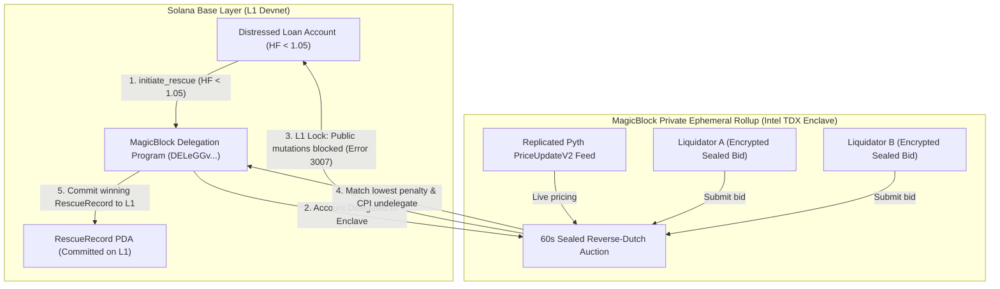

# Project Dossier: Rescue Protocol (`rescue` & `rescue2`)

**Dossier Generation Date:** October 3, 2026  
**Investigator:** Antigravity Engineering Portfolio Intelligence Analyst  
**Repository Paths:** [`/home/lala_02/rescue`](file:///home/lala_02/rescue) & [`/home/lala_02/rescue2`](file:///home/lala_02/rescue2)  
**Remote URLs:**  
- Protocol & Contracts: [`git@github.com:Olalolo22/rescue.git`](https://github.com/Olalolo22/rescue) (`main`)  
- Frontend & Telemetry: [`git@github.com:Olalolo22/rescue2.git`](https://github.com/Olalolo22/rescue2) (`main`, `mbv2`)  
**Live Deployment:** [`https://rescue-tawny-nine.vercel.app`](https://rescue-tawny-nine.vercel.app)  
**Solana Devnet Program ID:** [`ZnDqdjHjR1HuwyMehcfEGrxCt6QiCz58UW21VjbnGjf`](https://explorer.solana.com/address/ZnDqdjHjR1HuwyMehcfEGrxCt6QiCz58UW21VjbnGjf?cluster=devnet)  
**Settlement Proof Transaction:** [`3oJ6UfzqU8pwKCXVoFWVTzECRdU19vohdhZyo3wyVeWXCUvLS3b3aEDXMtv9coaxxuGxPBhs9SAq2E3VJQPz2WAq`](https://explorer.solana.com/tx/3oJ6UfzqU8pwKCXVoFWVTzECRdU19vohdhZyo3wyVeWXCUvLS3b3aEDXMtv9coaxxuGxPBhs9SAq2E3VJQPz2WAq?cluster=devnet)  
**MagicBlock TEE Validator:** `MTEWGuqxUpYZGFJQcp8tLN7x5v9BSeoFHYWQQ3n3xzo`  
**Evidence Standard:** **E1 (Live Devnet Deployment, Tested Transactions, Live Probe Suite)**

---

## A. Identity and Purpose

- **Project Name:** Rescue Protocol (and companion console `rescue2`)
- **What It Does:** A pre-liquidation intervention primitive for Solana lending protocols. When a borrower's collateral ratio drops into an at-risk "Intervention Zone" (Health Factor < 1.05), Rescue intercepts the position before adversarial MEV liquidators can trigger public liquidations. It delegates account custody into a **MagicBlock Private Ephemeral Rollup (Intel TDX hardware enclave)**, running a confidential, sealed reverse-Dutch auction where liquidators compete to offer the borrower the lowest liquidation penalty.
- **Specific Problem Addressed:** In public DeFi lending (e.g. Kamino, Solend), liquidation is an adversarial bloodbath. Searcher bots monitor the public mempool, front-run borrowers, and seize maximum statutory penalties (typically 5–10% of collateral). Borrowers suffer severe haircuts, and validators face network congestion. Base Solana cannot run sealed auctions because all state and mempools are public.
- **Intended Users:** 
  1. Distressed borrowers protecting collateral from catastrophic public liquidation haircuts.
  2. Solana lending protocols seeking lower bad-debt ratios and reduced liquidation cascades.
  3. Institutional liquidators competing for flow based on capital efficiency rather than mempool latency.
- **Origin & Hackathon Context:** Built for **MagicBlock Blitz 8** (Sprint timeline: September 4–11, 2026).

---

## B. Implementation Status & Verified State

- **Classification:** **Implemented, Verified on Devnet, and Live**
- **Verified State Milestones:**
  - [x] **Milestone 0: Empirical Hardware Probe Suite** ([`rescue/verification/probe-report.md`](file:///home/lala_02/rescue/verification/probe-report.md)): 7/7 live Devnet probes executed and passed against MagicBlock TEE validator `MTEWGuqx...`.
  - [x] **Milestone 1: Anchor On-Chain Program** ([`programs/rescue-protocol`](file:///home/lala_02/rescue/rescue-protocol/programs/rescue-protocol)): Host lending mechanics, `init_config`, `deposit_collateral`, `borrow`, `open_position`, and health factor math.
  - [x] **Milestone 2: TEE Ephemeral Rollup Integration:** `initiate_rescue`, `init_bid_permission`, `submit_bid`, `probe_cross_read`, and `undelegate_position` utilizing `ephemeral_rollups_sdk`.
  - [x] **Milestone 3: MEV Liquidation Lock:** Enforced hardware-level account lock via MagicBlock Delegation Program (`DELeGGvXpWV2fqJUhqcF5ZSYMS4JTLjteaAMARRSaeSh`). Verified that base layer mutations fail deterministically with Anchor error `3007 (AccountOwnedByWrongProgram)`.
  - [x] **Milestone 4: Automation & Simulation Harness** ([`rescue-protocol/scripts`](file:///home/lala_02/rescue/rescue-protocol/scripts)):
    - `keeper.ts`: Autonomous crank monitoring loan health via Pyth feeds and initiating delegation.
    - `mev-attacker.ts`: Adversarial bot attempting public base liquidations on delegated loans (proves error 3007).
    - `rescuer.ts`: Private sealed bidder placing encrypted bids inside the TEE enclave.
    - `run-e2e.ts`: End-to-end multi-agent orchestration script.
  - [x] **Milestone 5: Interactive Web Console & Live Telemetry Wire (`rescue2`):** Next.js app streaming live TEE slot execution and SOL price telemetry from Devnet.

---

## C. Actual Contributions & Authorship

- **Attribution:** **100% authored by the user** (`Olumidelala <olumide2956@gmail.com>`).
- **Personal Engineering Deliverables:**
  1. Conceived and specified the entire pre-liquidation reverse-auction mechanism design ([`ARCHITECTURE.md`](file:///home/lala_02/rescue/ARCHITECTURE.md), 38,380 bytes).
  2. Implemented the complete Anchor smart contract suite in Rust, including fixed-point arithmetic (`math.rs`) for health factor boundaries.
  3. Formulated and ran the 7 empirical hardware probes on live Devnet to measure latency and test error boundaries.
  4. Wrote the off-chain keeper crank, adversarial MEV simulation bot, and E2E TypeScript harness.
  5. Built and deployed the frontend telemetry console on Vercel.

---

## D. Technical Architecture

### Key Technical Mechanisms
1. **The Intervention Zone (Buffer Math):**  
   From Probe 05, delegation activation latency was empirically measured at **4,624ms (~4.6 seconds)**. To prevent a position from crossing liquidation during the delegation transition, Rescue defines the Intervention Zone at **300–500 bps (3–5%)** above the host protocol liquidation threshold.
2. **Deterministic Cryptographic MEV Lock (Anchor Error 3007):**  
   Once delegated, the base Solana runtime assigns account ownership to the MagicBlock delegation program. Any searcher bot attempting to call `liquidate` on base layer receives an immediate, unbypassable Solana runtime error: `AccountOwnedByWrongProgram (3007)`.
3. **Zero-L1-Trace Ephemeral Accounts (`#[ephemeral_accounts]`):**  
   Bids placed by liquidators (`LenderBidPDA`, 49 bytes) exist strictly within TEE volatile memory. They close upon auction resolution with **0 bytes written to Solana L1**, preventing liquidators' pricing strategies and capital commitments from leaking to historical block explorers.

---

## E. Verification & Empirical Hardware Evidence

The live verification suite ([`rescue/verification/probe-report.md`](file:///home/lala_02/rescue/verification/probe-report.md)) establishes direct **E1 verification**:

| Probe # | Tested Property | Result | Concrete Measured Metric | Authoritative Evidence |
| :---: | :--- | :---: | :--- | :--- |
| **01** | EphemeralPermission Multi-Member Privacy | **PASS** | External `getAccountInfo` returned `null` inside TEE. | `probe-report.md:L16` |
| **02** | CPI Undelegate & Ownership Return | **PASS** | Ownership returned cleanly to host program in 0.0s upon bundle commit. | `probe-report.md:L17` |
| **03** | Delegated Mutation Lock | **PASS** | Base layer mutations deflected with Anchor Error 3007. | `probe-report.md:L18` |
| **04** | Pyth Oracle Replication | **PASS** | `PriceUpdateV2` indexed inside TEE (134 bytes matched). | `probe-report.md:L19` |
| **05** | Delegation Activation Latency | **PASS** | **Base confirmation: 3,080ms + ER sync: 1,544ms = 4,624ms (~4.6s).** | `probe-report.md:L20` |
| **06** | Adversarial MEV Liquidation Lock | **PASS** | MEV Searcher bot completely deflected with Anchor Error 3007. | `probe-report.md:L21` |
| **07** | Ephemeral Account Zero-L1 Footprint | **PASS** | Sealed bids exist purely on ER (len=49) and close with 0 base traces. | `probe-report.md:L22` |

---

## F. Metrics & Claims Ledger

| Claim ID | Claim Description | Verified Metric / Value | Evidence Source | Confidence |
| :--- | :--- | :--- | :--- | :---: |
| `CLM-RESCUE-001` | Deployed working pre-liquidation reverse-auction protocol on Solana Devnet. | Program ID: `ZnDqdjHjR1HuwyMehcfEGrxCt6QiCz58UW21VjbnGjf` | Solana Explorer Devnet | **E1 (Direct)** |
| `CLM-RESCUE-002` | Executed end-to-end settlement committing winning RescueRecord to L1. | Tx: `3oJ6UfzqU8pwKCXVoFWVTzEC...` | Solana Explorer Devnet | **E1 (Direct)** |
| `CLM-RESCUE-003` | Empirically benchmarked MagicBlock delegation activation latency. | **4,624ms total (3,080ms base + 1,544ms ER sync)** | `probe-report.md:L20` | **E1 (Direct)** |
| `CLM-RESCUE-004` | Verified cryptographic MEV deflection of base layer liquidations. | Anchor Runtime Error 3007 (`AccountOwnedByWrongProgram`) | `probe-report.md:L21`, `mev-attacker.ts` | **E1 (Direct)** |
| `CLM-RESCUE-005` | Authored complete 5-agent simulation and keeper crank harness. | 5 TypeScript scripts (`keeper.ts`, `mev-attacker.ts`, `rescuer.ts`, etc.) | `rescue-protocol/scripts/` | **E1 (Direct)** |

---

## G. Limitations & Engineering Trade-Offs

1. **Activation Latency Constraint (~4.6s):**  
   Because delegating account ownership from Solana L1 to the TEE ER takes ~4.6 seconds, Rescue cannot protect loans that crash faster than 4.6 seconds into insolvency. The protocol mathematically requires an Intervention Buffer (3–5% above liquidation).
2. **Devnet Validator Dependency:**  
   Relies on MagicBlock's devnet TEE validator (`MTEWGuqx...`). If the TEE validator experiences downtime, positions cannot be delegated, and the host protocol must fall back to standard base-layer liquidations.
3. **Pyth Clock Skew:**  
   Clock variance between Solana base validators and the TEE node required setting `MAX_PRICE_AGE_SECONDS = 600` to prevent transient stale-oracle errors.

---

## H. Interview-Ready Talking Points

- **One-Sentence Pitch:**  
  *"Rescue is a Solana pre-liquidation primitive that uses MagicBlock Private Ephemeral Rollups inside Intel TDX enclaves to intercept distressed loans into a sealed reverse auction, shielding borrowers from predatory MEV liquidators."*
- **30-Second Technical Walkthrough:**  
  *"In DeFi, liquidations are public zero-sum races where bots front-run borrowers for maximum penalties. I built Rescue to delegate underwater accounts into a hardware-isolated TEE enclave before liquidation. Once delegated, base layer liquidations fail deterministically with Anchor runtime error 3007. Inside the TEE, liquidators compete in a confidential sealed auction to offer the borrower the lowest penalty. I deployed it on Devnet, proved the MEV lock against an adversarial bot, and benchmarked the delegation latency at 4.6 seconds across 7 empirical hardware probes."*
- **Difficult Interview Question You Can Defend:**  
  *Q: What happens if the market crashes faster than the 4.6-second delegation window?*  
  *A: That was the exact question Probe 05 was designed to answer. By measuring base confirmation (3,080ms) and ER sync (1,544ms), I proved the total lag is ~4.6s. To prevent bad debt, Rescue defines an Intervention Zone 300–500 bps above the hard liquidation threshold. If volatility is so extreme that the price blows through that 5% buffer within 4.6 seconds, the position cannot complete delegation and the protocol defaults safely to standard base liquidation.*
