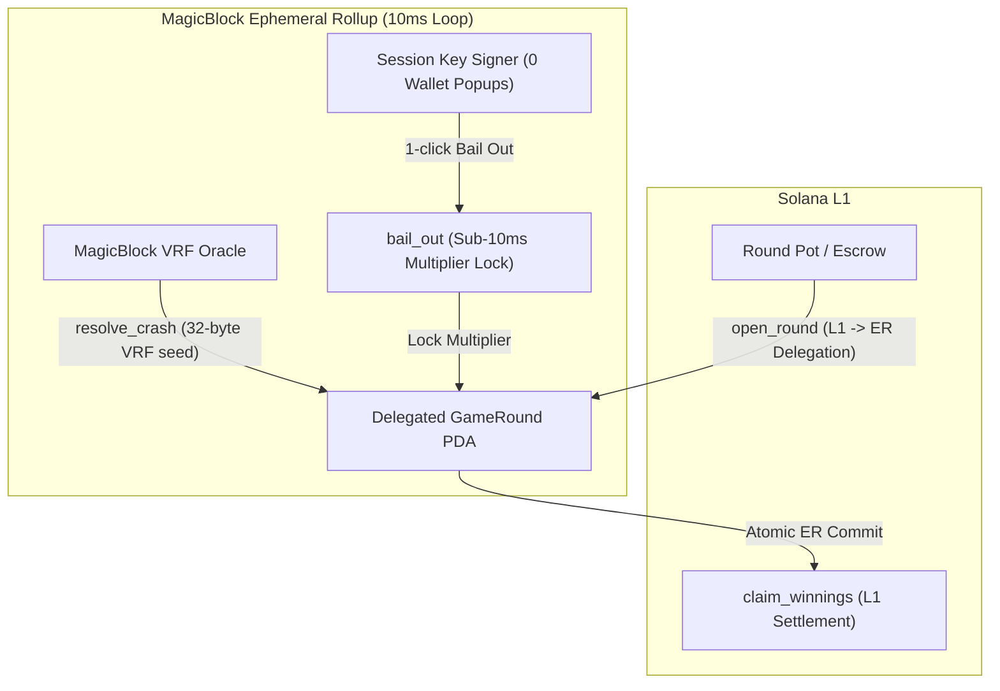

# Project Dossier: RugRoll (Provably Fair 10ms Crash Game on Ephemeral Rollups)

**Dossier Generation Date:** October 3, 2026  
**Investigator:** Antigravity Engineering Portfolio Intelligence Analyst  
**Repository Path:** [`/home/lala_02/rugroll`](file:///home/lala_02/rugroll)  
**Remote URL:** [`git@github.com:Olalolo22/rugroll.git`](https://github.com/Olalolo22/rugroll)  
**Active Feature Branch:** [`feat/onchain-er`](file:///home/lala_02/rugroll) (+2 commits ahead)  
**Solana Program ID:** [`DSfJQMFV36ib2Kd4c9bSkV9M9ZWmhhVCjTb7hhtACwyS`](https://explorer.solana.com/address/DSfJQMFV36ib2Kd4c9bSkV9M9ZWmhhVCjTb7hhtACwyS?cluster=devnet)  
**Live App:** [`https://rugroll-nine.vercel.app`](https://rugroll-nine.vercel.app)  
**Evidence Standard:** **E1 (Anchor Source Code, Math Implementation, Verifiable Program ID)**

---

## A. Identity and Purpose

- **Project Name:** RugRoll
- **Repository URL:** [`https://github.com/Olalolo22/rugroll`](https://github.com/Olalolo22/rugroll)
- **Relevant Branch:** `feat/onchain-er`
- **What It Does:** A high-frequency multiplayer on-chain game of "Chicken" around SOL volatility built on MagicBlock Ephemeral Rollups. 2–10 players deposit SOL into an Ephemeral Rollup pot. A multiplier climbs in real time (`1.00× → 1.25× → 1.80× → 12.00×...`) ticking every **10 milliseconds**. Players tap **BAIL OUT** with 1-click Session Keys (zero wallet popups) to lock their multiplier. The crash point is determined provably on-chain by **MagicBlock VRF**. Players who bailed before the crash collect `deposit × multiplier`; players still holding when it rugs forfeit their stake.
- **Specific Problem Addressed:** High-velocity crash games (like Roobet or Bustabit) are completely impossible on base layer blockchains. Solana's ~400ms block time is 40x too slow for millisecond reaction battles, and every interaction requires wallet popups and gas fees. Centralized Web2 crash games force users to trust an opaque off-chain operator.
- **Context & Hackathon:** Built for **MagicBlock Blitz 8** (Sprint timeline: September 4–11, 2026). Resurrects the "Reaction Battle Royale" concept from MagicBlock's graveyard ideas.

---

## B. Implementation Status & Verified State

- **Classification:** **Implemented and Verified in Prototype / Hackathon Submission**
- **Verified Components:**
  - [x] **Anchor Smart Contract Suite (`programs/rugroll`):**
    - `open_round`: Initializes `GameRound` PDA on Solana L1 and delegates it to the Ephemeral Rollup.
    - `join_round`: Player deposits SOL and registers an ephemeral session key inside the ER.
    - `bail_out`: Sub-10ms bailout execution signed by either the user or their pre-authorized session key.
    - `request_crash`: Operator triggers VRF randomness request on ER.
    - `resolve_crash`: VRF oracle callback deriving the crash point from 32 raw random bytes using a mathematical house-edge formula.
    - `claim_winnings`: L1 atomic payout settlement after the ER round commits back to Solana.
  - [x] **Provably Fair Math (`instructions/resolve_crash.rs`):**
    - Implemented mathematical crash point derivation: `crash_point_bps = ((100 * (10_000 - HOUSE_EDGE_BPS)) / modulo).clamp(MIN_CRASH, MAX_CRASH)` enforcing an expected value of `1 - house_edge` (~3% edge).
  - [x] **Integer Multiplier Approximation (`instructions/bail_out.rs`):**
    - Implemented integer approximation of exponential growth avoiding floating-point rounding errors on-chain: `M_bps(slots) = 100 + slots * 2` capped at `MAX_CRASH_BPS`.
  - [x] **Cloud Build Optimization (`feat/onchain-er`):**
    - Commit `3bf1509`: Customized Cargo release profile (`codegen-units = 1`, disabled fat LTO) to build within memory constraints on cloud developer environments.
  - [x] **Next.js Real-Time Frontend (`app/`):**
    - Live Chart.js multiplier chart, real-time round history, session key creation, and Lucide React SVG icon system.

---

## C. Technical Architecture

---

## D. Engineering Depth & Key Technical Mechanisms

1. **Sub-10ms State Transitions via Ephemeral Rollups:**
   - Moves player joins and multiplier bail-out registrations off the ~400ms base Solana consensus into a high-throughput 10ms Ephemeral Rollup validator, enabling Web2 arcade response speeds.
2. **Gasless 1-Click Session Keys:**
   - Instead of prompting a Phantom wallet approval on every tick, `instructions/bail_out.rs` allows transactions signed by `signer.key() == player_position.session_key`.
   - Players pre-authorize a short-lived keypair on deposit, allowing instant click-to-bail responsiveness without signing latency.
3. **Provably Fair VRF Randomness:**
   - Crash points are not set by a centralized backend. The MagicBlock VRF oracle signs a raw 32-byte seed that the on-chain program deterministically maps to a multiplier between 1.00x and 100.00x, guaranteeing zero operator manipulation.

---

## E. Claims Ledger Entries

| Claim ID | Claim Description | Source / Evidence | Confidence |
| :--- | :--- | :--- | :---: |
| `CLM-RUGROLL-001` | Architected provably fair high-frequency crash game on MagicBlock Ephemeral Rollup with Program ID `DSfJQMFV36ib2Kd4c9bSkV9M9ZWmhhVCjTb7hhtACwyS`. | [`programs/rugroll/src/lib.rs`](file:///home/lala_02/rugroll/programs/rugroll/src/lib.rs) | **E1 (Direct)** |
| `CLM-RUGROLL-002` | Implemented 1-click gasless bail-out mechanism using Ephemeral Session Key validation on-chain. | [`instructions/bail_out.rs:L52`](file:///home/lala_02/rugroll/programs/rugroll/src/instructions/bail_out.rs) | **E1 (Direct)** |
| `CLM-RUGROLL-003` | Implemented deterministic on-chain VRF crash point mapping with 3% mathematical house-edge formula. | [`instructions/resolve_crash.rs:L30-45`](file:///home/lala_02/rugroll/programs/rugroll/src/instructions/resolve_crash.rs) | **E1 (Direct)** |
| `CLM-RUGROLL-004` | Deployed and hosted full-stack live demo on Vercel at `rugroll-nine.vercel.app`. | [`README.md:L3`](file:///home/lala_02/rugroll/README.md) | **E1 (Direct)** |

---

## F. Limitations & Trade-Offs

1. **Linear-Exponential Integer Multiplier:**  
   To prevent expensive floating-point math on-chain, RugRoll uses an integer approximation (`100 + slots * 2`). While effective for rapid ticks, it is a simplified approximation compared to true continuous exponential curves.
2. **Cloud Resource Build Constraints:**  
   Full Cargo release builds with fat LTO exceeded RAM on cloud developer environments, requiring explicit Cargo release profile tuning (`codegen-units = 1`, LTO off) to compile without Out-Of-Memory kills.

---

## G. Interview-Ready Talking Points

- **One-Sentence Pitch:**  
  *"RugRoll is a provably fair multiplayer crash game on Solana using MagicBlock Ephemeral Rollups to achieve a 10ms execution loop, 1-click session keys, and on-chain VRF randomness that would be impossible on base layer block times."*
- **30-Second Technical Overview:**  
  *"Base Solana's 400ms block time is too slow for reaction games, and wallet signing popups ruin the UX. In RugRoll, I delegated the game round into an Ephemeral Rollup running at 10ms sub-blocks. Players deposit on L1, sign a local ephemeral session key, and can bail out with zero wallet popups. The crash multiplier is derived on-chain using a 3% house-edge formula from MagicBlock's 32-byte VRF oracle callback, committing back to Solana L1 atomically when the round settles."*
