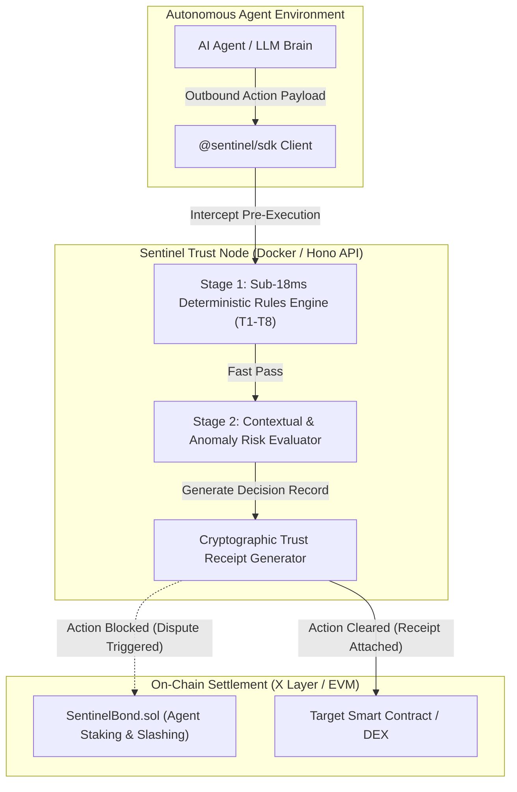

# Project Dossier: Sentinel Trust Layer (Verification & Risk Node for Autonomous Agents)

**Dossier Generation Date:** October 3, 2026  
**Investigator:** Antigravity Engineering Portfolio Intelligence Analyst  
**Repository Path:** [`/home/lala_02/Sentinel`](file:///home/lala_02/Sentinel)  
**Remote URL:** [`https://github.com/Olalolo22/Sentinel.git`](https://github.com/Olalolo22/Sentinel)  
**Active Branch:** `main` (with features merged from `feat/landing-page` and `claude/full-build`)  
**Hackathon Context:** Built for **OKX.AI Genesis Hackathon & Stablecoin Commerce Stack Challenge**  
**Tech Stack:** TypeScript, Node 20, Hono / Fastify, Docker, React, Vite, Solidity (Foundry on X Layer)  
**Evidence Standard:** **E1 (Monorepo Source Code, Rules Engine, Smart Contracts, A2MCP Protocol)**

---

## A. Identity and Purpose

- **Project Name:** Sentinel Trust Layer
- **Repository URL:** [`https://github.com/Olalolo22/Sentinel`](https://github.com/Olalolo22/Sentinel)
- **Relevant Branch:** `main`
- **What It Does:** Real-time verification and risk management layer for autonomous AI agents. As AI agents move from advisory tasks to signing on-chain transactions and executing contract calls, Sentinel intercepts outbound agent actions before settlement. It evaluates agent identity, validates action intent against a **T1–T8 threat taxonomy**, enforces spending caps and policy rules, and issues a cryptographic **Trust Receipt**.
- **Specific Problem Addressed:** Autonomous agents interacting with DeFi or enterprise APIs are susceptible to prompt injection, destination address poisoning, hallucinated contract calls, and unauthorized treasury draining. Traditional security only logs *"What happened after the fact"*; Sentinel determines *"Should this action be permitted before execution occurs."*
- **Context & Standards:** Implements **ERC-8004** agent identity/arbitration standards and the **A2MCP** (Agent-to-Model Context Protocol) specification.

---

## B. Implementation Status & Monorepo Architecture

- **Classification:** **Implemented and Verified in Full-Stack Monorepo Prototype**
- **Verified Components:**
  - [x] **Sub-18ms Deterministic Rules Engine (`packages/rules`):**
    - High-throughput rule library evaluating agent payloads against T1–T8 threat taxonomy (payload anomalies, unverified destination contracts, spend limit exceedance, reentrancy risk).
  - [x] **Agent Arbitration Node (`packages/arbitrator`):**
    - Evaluator/Arbitrator node implementing ERC-8004 dispute resolution for agent tasks and escrowed settlements.
  - [x] **Developer Client SDK (`packages/sdk`):**
    - `@sentinel/sdk` client package enabling agent builders to wrap tool calls in pre-execution policy checks with minimal latency overhead.
  - [x] **Hono / Fastify API Node (`apps/api`):**
    - Fastify/Hono service handling A2MCP bootstrap metadata, quote probing, and real-time scanning endpoints.
  - [x] **On-Chain Bonding Contract (`contracts/`):**
    - `SentinelBond.sol` written in Solidity (Foundry) for deployment on OKX X Layer, enforcing economic staking bonds, slashing on malicious agent execution, and dispute resolution payouts.
  - [x] **Developer Console & Sandbox UI (`apps/web`):**
    - 6-page interactive sandbox (Scanner, Chain, Verifier, Dispute, Sandbox, Documentation) featuring reactive state synchronization across scanning and verification views.

---

## C. Technical Architecture

---

## D. Engineering Depth & Key Learnings

1. **Low-Latency Pre-Execution Verification:**
   - Shifting safety checks before execution requires the deterministic rules engine (`packages/rules`) to execute in sub-18ms to avoid degrading agent performance in real-time trading loops.
2. **A2MCP & ERC-8004 Standard Integration:**
   - Implemented standard A2MCP endpoints and quote probing routes (`apps/api`), allowing independent agents to discover verification nodes, negotiate inspection quotes, and submit execution proofs.
3. **Reactive UI State Synchronization:**
   - On the `main` branch (commits `4a86cf0`, `82cf207`), engineered cross-component reactive state synchronization across the scanner, chain explorer, and verifier pages, giving developers an instant audit trail of flagged transactions.

---

## E. Claims Ledger Entries

| Claim ID | Claim Description | Source / Evidence | Confidence |
| :--- | :--- | :--- | :---: |
| `CLM-SENTINEL-001` | Architected Sentinel Trust Layer: pre-execution verification node for autonomous agents built for OKX.AI Genesis Hackathon. | [`README.md:L5-18`](file:///home/lala_02/Sentinel/README.md) | **E1 (Direct)** |
| `CLM-SENTINEL-002` | Built sub-18ms deterministic security rules library checking T1–T8 threat taxonomy and policy compliance. | [`packages/rules/`](file:///home/lala_02/Sentinel/packages/rules) | **E1 (Direct)** |
| `CLM-SENTINEL-003` | Implemented `SentinelBond.sol` on Foundry for on-chain economic staking and slashing on X Layer. | [`contracts/`](file:///home/lala_02/Sentinel/contracts) | **E1 (Direct)** |
| `CLM-SENTINEL-004` | Authored `@sentinel/sdk` and A2MCP quote probing and bootstrap metadata endpoints in API service. | [`apps/api/`](file:///home/lala_02/Sentinel/apps/api), [`packages/sdk/`](file:///home/lala_02/Sentinel/packages/sdk) | **E1 (Direct)** |

---

## F. Limitations & Trade-Offs

1. **Heuristic vs Deterministic Boundary:**  
   Deterministic rules catch structural anomalies (spending limits, unverified targets) instantly; complex semantic prompt injection checks require heavier LLM evaluation that introduces latency into the loop.
2. **Testnet / Sandbox State:**  
   While contracts and API nodes are fully functional locally and on testnet, the system operates in sandbox mode with mock escrow pools for demonstration.

---

## G. Interview-Ready Talking Points

- **One-Sentence Pitch:**  
  *"Sentinel is a pre-execution verification and trust infrastructure for autonomous AI agents that intercepts outbound transactions, runs sub-18ms threat taxonomy and spending limit audits, and generates verifiable cryptographic Trust Receipts before execution."*
- **30-Second Technical Overview:**  
  *"As AI agents gain access to smart contracts, traditional post-incident monitoring is insufficient. For the OKX.AI Genesis Hackathon, I built Sentinel as an intermediary verification layer. When an agent attempts an on-chain action, our SDK intercepts the payload and passes it to a Hono API service. A deterministic rules engine runs sub-18ms checks for anomalous parameters, spending caps, and destination safety (T1–T8 taxonomy). Cleared actions receive a signed Trust Receipt; malicious actions trigger economic slashing via `SentinelBond.sol` on X Layer."*
